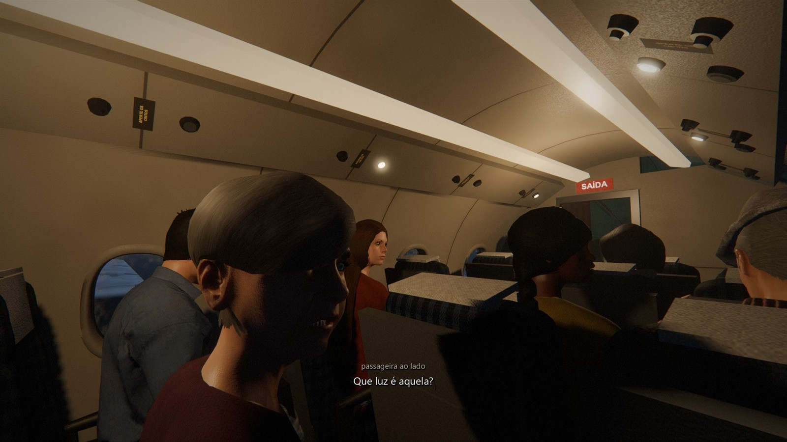
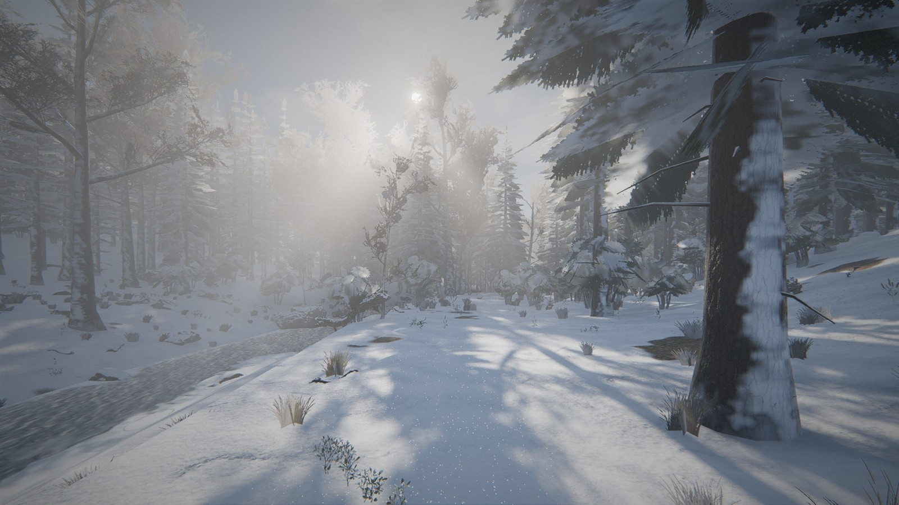
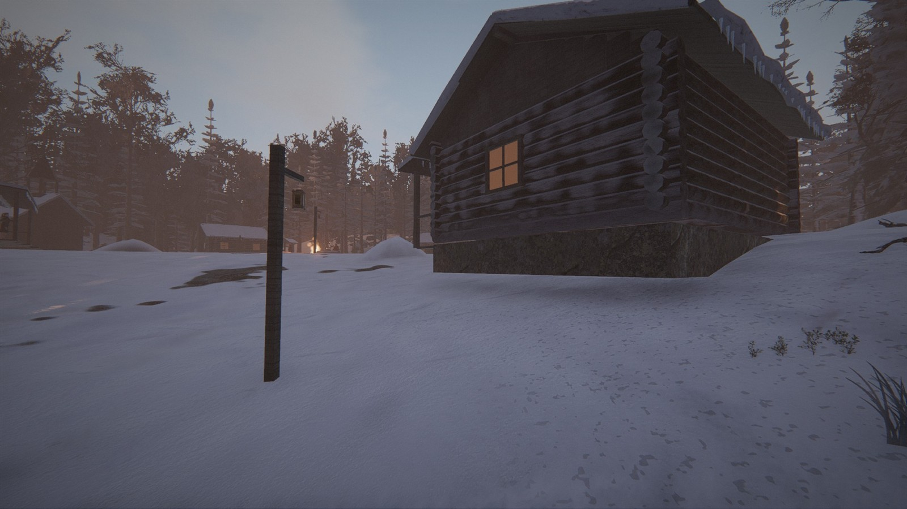
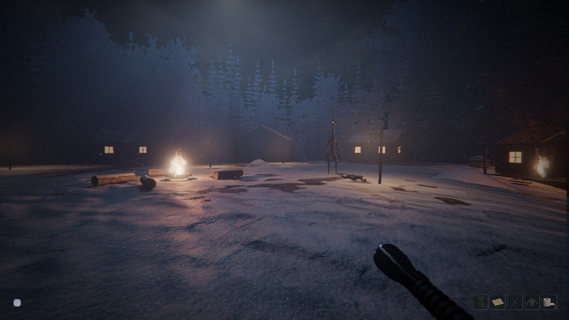
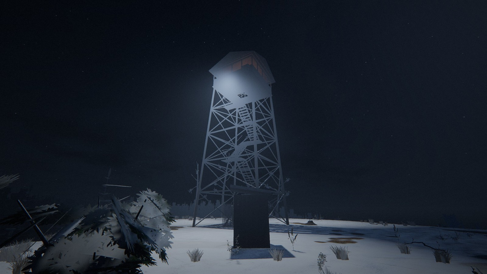

# HOLLER — não responda

Terror e sobrevivência em primeira pessoa para PC, feito em Godot 4.7.

Janeiro de 1987. O voo 609 cai de madrugada nos montes Apalaches, cobertos de neve.
Você acorda com o sol nascendo, entre os mortos. Há uma vila circulada no mapa: chegue lá
antes de escurecer. E, se ouvir alguém chamar o seu nome na mata, não responda.

<p align="center">
  <a href="https://github.com/AvoSalesCompany/apalache/releases/latest/download/HOLLER-Instalador.exe">
    
  </a>
</p>
<p align="center">
  Baixe, abra o instalador e clique no ícone <b>HOLLER</b> na área de trabalho. Windows 10 ou 11 (64 bits).
</p>


| | |
|---|---|
|  |  |
|  |  |
|  |  |

## Como jogar

**Jogar pronto:**
1. Clique no botão **Baixar o jogo** aqui em cima.
2. Abra o `HOLLER-Instalador.exe`. Se o Windows avisar que o aplicativo é desconhecido, clique em
   **Mais informações** e depois em **Executar assim mesmo** (o jogo ainda não tem assinatura digital).
3. Clique em **Instalar**. O ícone do HOLLER aparece na área de trabalho: é só clicar e jogar.

Precisa de placa de vídeo com Vulkan. Ficou lento? *Esc → Opções → Qualidade: Baixa*.

**Pelo código:**
1. Baixe o [Godot 4.7.2](https://godotengine.org/download) (versão padrão, 64 bits).
2. Abra o Godot, clique em *Importar* e escolha `jogo/project.godot`.
3. Aperte **F5**.

| Tecla | Ação |
|---|---|
| WASD / mouse | andar / olhar |
| Shift / Ctrl / Espaço | correr / agachar / pular e proteger a cabeça no avião |
| E | usar, pegar e soltar objetos (algumas coisas pedem segurar) |
| Tab ou I | mochila (inventário com ícones) |
| M | mapa |
| F | lanterna |
| 2 / R | empunhar o rifle / recarregar |
| Q | gritar por socorro (pense bem) |
| C | segurar a bússola |
| Clique esquerdo | atirar, ou arremessar objeto |
| Botão direito | mirar / focar a visão |
| H / Esc | curativo / pausa |

Jogue com fones de ouvido. Se o mato calar, ela está perto.

## O que já existe (v0.3)

- **Voo 609:** passageiros com rosto, pele, cabelo e gestos; vizinha de poltrona para conversar, revista, luz de
  leitura e a comissária servindo o lanche (você escolhe) antes de tudo dar errado.
- **Inverno:** neve no chão, nas árvores, nos telhados e caindo; pegadas, bafo no ar, riacho com gelo nas margens.
- **Dia e noite:** o sol nasce nos destroços, se põe na vila, e só volta a nascer quando a polícia chega.
- **Destroços:** quem não sobreviveu, mochila com mapa, casaco, curativos, bússola, lanterna.
- **Mochila e mapa:** inventário com ícones, descrição, notas lidas e a sua posição no mapa.
- **De dia nada ataca.** Só bandos de pássaros fugindo, altos, todos para o mesmo lado.
- **Cold Holler:** vila com cinco moradores que falam, contam a história dos montes e dão abrigo.
- **O ataque:** no meio da noite a vila é invadida. Corra para a Torre 4.
- **Torre 4:** trancada, sem energia. A chave está onde ninguém queria; a gasolina ficou na vila destruída.
- **O cerco:** depois de chamar ajuda, ela pode matar. Três golpes matam você. Três tiros matam ela.
- **Dois finais**, salvamento automático, opções de qualidade e legendas em português.

## Organização

```
jogo/            projeto Godot
  cenas/         cena inicial
  scripts/       código (GDScript, comentado em português)
  shaders/       lua, céu, névoa, água, terreno, pele da criatura
  mod/ tex/      modelos e texturas
  som/           áudio sintetizado
  dados/         mundo pré-calculado
  ferr/          ferramenta que recalcula o mundo
ferramentas/     scripts que baixam assets e geram áudio, folhagem e ícone
instalador/      instalador do Windows (Inno Setup)
.github/         monta e publica o jogo quando uma versão é marcada
docs/            design, pesquisa e imagens
```

| Quero mudar... | Arquivo |
|---|---|
| Roteiro, notas, finais | `jogo/scripts/historia.gd` |
| Falas (texto, voz e velocidade) | `ferramentas/falas.txt`, depois `gerar_audio2.ps1 -SoVozes` |
| Ritmo do terror e ondas do cerco | `jogo/scripts/diretor.gd` |
| Pessoas: aparência | `jogo/ferr/gente_assar.gd` |
| Pessoas: poses, rosto e gestos | `jogo/scripts/gente.gd` |
| Vila: casas, interior, moradores, ruína | `jogo/scripts/vila.gd` |
| Sol, lua, neblina e neve | `jogo/scripts/clima.gd` |
| Itens e ícones / mochila e mapa | `jogo/scripts/itens.gd` / `inventario.gd` |
| Rifle | `jogo/scripts/rifle.gd` |
| Comportamento da criatura | `jogo/scripts/criatura.gd` |
| Vigias, vultos e sustos | `jogo/scripts/anomalias.gd` e `vigia.gd` |
| Lanterna | `jogo/scripts/lanterna.gd` |
| Modelo do avião | `jogo/scripts/aeronave.gd` |
| Objetos com física | `jogo/scripts/objeto_fisico.gd` |
| Andar, frio, fôlego | `jogo/scripts/jogador.gd` |

| Posição dos lugares, rio e estradas | `jogo/scripts/mundo.gd`, depois rodar a ferramenta abaixo |
| Cena do avião | `jogo/scripts/aviao.gd` |

### Ferramentas

Recalcular o mundo depois de mexer em `mundo.gd` ou `assar.gd`:

```bash
godot --path jogo --headless res://ferr/assar.tscn -- mundo
```

Robô que joga a partida inteira e relata onde travou:

```bash
godot --path jogo -- robo=1 vel=3
```

Refazer as pessoas (precisa dos dados CC0 do MakeHuman baixados numa pasta):

```bash
godot --path jogo --headless res://ferr/assar.tscn -- gente mh=C:/pasta
```

Publicar uma versão nova (o GitHub monta o instalador e atualiza o botão de download sozinho):

```bash
git tag v0.4.0
git push origin v0.4.0
```

Exportar o `.exe` no seu PC: no Godot, *Editor → Gerenciar modelos de exportação*, depois *Projeto → Exportar → Windows*.

## Créditos e licenças

Veja [CREDITOS.md](CREDITOS.md). Importante para a Steam: **as falas são provisórias**
(voz sintética do Windows) e precisam ser regravadas antes de vender o jogo.
