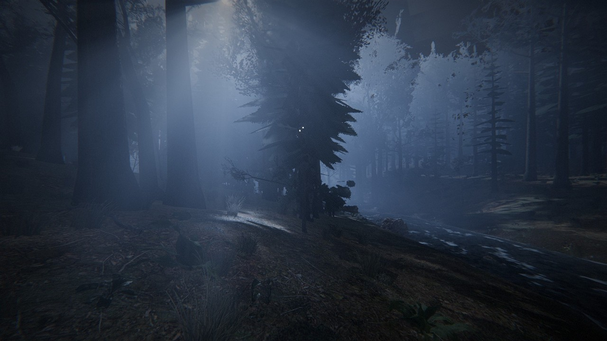
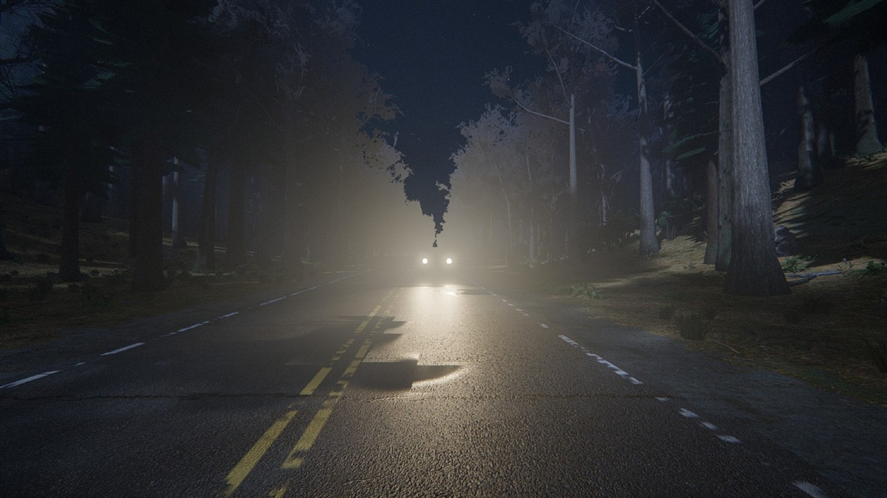

# HOLLER — não responda

Terror e sobrevivência em primeira pessoa para PC, feito em Godot 4.7.

Outubro de 1987. O voo 609 cai de madrugada no meio dos montes Apalaches. As poltronas
estão vazias, os cintos continuam afivelados e alguma coisa na mata já sabe o seu nome.
A única luz é a da lua. Ache a civilização.


| | |
|---|---|
|  |  |
|  |  |

## Como jogar

**Jogar pronto:** baixe `HOLLER.exe` na página de *Releases*, quando houver uma publicada.

**Pelo código:**
1. Baixe o [Godot 4.7.2](https://godotengine.org/download) (versão padrão, 64 bits).
2. Abra o Godot, clique em *Importar* e escolha `jogo/project.godot`.
3. Aperte **F5**.

| Tecla | Ação |
|---|---|
| WASD / mouse | andar / olhar |
| Shift / Ctrl / Espaço | correr / agachar / pular e proteger a cabeça no avião |
| E | usar (algumas coisas pedem segurar) |
| Q | gritar por socorro (pense bem) |
| C | segurar a bússola |
| F ou clique esquerdo | arremessar pedra para distrair |
| Botão direito | focar a visão |
| H / Tab / Esc | curativo / caderno / pausa |

Jogue com fones de ouvido: **os grilos são o seu radar.** Se o mato calar, ele está perto.

## O que já existe (v0.1)

- **Abertura:** voo noturno, luz que acompanha o avião, pane, turbulência e queda.
- **Mapa aberto** de 1 km²: 32 mil árvores, riacho, cabana, cemitério, torre de incêndio, ponte, rodovia e posto.
- **O Chamador:** criatura com visão, audição e memória, que imita a voz de quem morreu.
- **Diretor de tensão:** um segundo cérebro decide quando apertar e quando dar descanso.
- **Sobrevivência:** frio, fôlego, ferimentos, medo e exposição ao luar (ícone da lua).
- **As regras da serra** são mecânicas: não grite, não responda, não siga as luzes, cale quando o mato calar.
- **Dois finais**, salvamento automático, opções de qualidade e legendas em português.

## Organização

```
jogo/            projeto Godot
  cenas/         cena inicial
  scripts/       código (GDScript, comentado em português)
  shaders/       lua, céu, névoa, água, terreno, pele da criatura
  mod/ tex/      modelos e texturas
  som/           áudio sintetizado
  dados/         mundo pré-calculado
  ferr/          ferramenta que recalcula o mundo
ferramentas/     scripts que baixam assets e geram áudio e folhagem
docs/            design, pesquisa e imagens
```

| Quero mudar... | Arquivo |
|---|---|
| Roteiro, notas, finais | `jogo/scripts/historia.gd` |
| Ritmo do terror, vozes, luzes falsas | `jogo/scripts/diretor.gd` |
| Comportamento da criatura | `jogo/scripts/criatura.gd` |
| Andar, frio, fôlego | `jogo/scripts/jogador.gd` |
| Luz da lua e neblina | `jogo/scripts/floresta.gd`, função `_luz_e_ceu` |
| Posição dos lugares, rio e estradas | `jogo/scripts/mundo.gd`, depois rodar a ferramenta abaixo |
| Cena do avião | `jogo/scripts/aviao.gd` |

### Ferramentas

Recalcular o mundo depois de mexer em `mundo.gd` ou `assar.gd`:

```bash
godot --path jogo --headless res://ferr/assar.tscn -- mundo
```

Robô que joga a partida inteira e relata onde travou:

```bash
godot --path jogo -- robo=1 vel=3
```

Exportar o `.exe`: no Godot, *Editor → Gerenciar modelos de exportação*, depois *Projeto → Exportar → Windows*.

## Créditos e licenças

Veja [CREDITOS.md](CREDITOS.md). Importante para a Steam: **as falas são provisórias**
(voz sintética do Windows) e precisam ser regravadas antes de vender o jogo.
